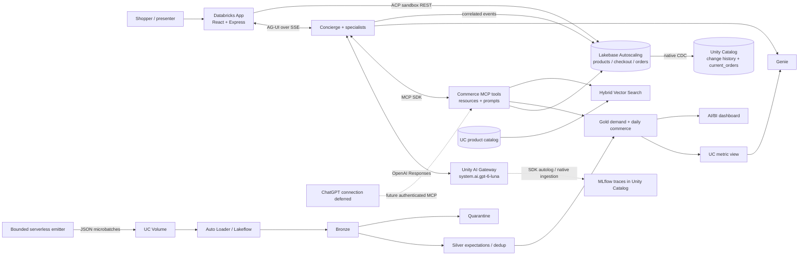

# ShopiBricks architecture

All resources are in FEVM serverless stable, using explicit CLI profile `fevm`. Product, customer, traffic and payment data are synthetic.

## Operational and analytical truth

The application reads current price and stock from Lakebase. Checkout uses transactions, row locks, authoritative recomputation, and request-bound idempotency. The UI requires an explicit confirmation before creating a sandbox order. Rehearsals decrement actual demo stock but never call a payment service.

Native Lakebase CDC writes `lb_*_history` tables into `serverless_stable_vwywqi_catalog.shopibricks_laurent`. `current_orders` selects the latest event for each order, excluding preimages and deletes. CDC is asynchronous; the same sandbox order ID has been observed in both stores.

The separate synthetic campaign stream writes 240-event microbatches about every 15 seconds, bounded by a requested duration. A serverless job triggers incremental Lakeflow updates while emitting and waits for its final flush. Gold data refreshes at pipeline completion, not on each UI frame. No perpetual schedule is enabled.

The presenter stockout button explicitly changes Lakebase stock. It is separate from the synthetic campaign generator. The analytical product catalog and vector index contain descriptive catalog information; live availability must always be checked against Lakebase.

## Agent and protocol boundaries

The concierge delegates to Catalog, Inventory, Checkout and Merchant analyst specialists. Each uses the same governed OpenAI model with different tool sets. Catalog and inventory access go through the official MCP SDK. The browser receives AG-UI run, text, tool and structured-card events. Generated content selects validated React components; it is not arbitrary executable UI.

Product-card prices and totals are computed from authoritative catalog records. Explicit EUR budgets carry forward through the conversation; an over-budget shortlist is rejected before a UI event is emitted, allowing the specialist to retry. Comparison cards show alternatives only when requested and do not imply a combined purchase total.

The MCP server also exposes Streamable HTTP at `/mcp`, typed read-only tools, a commerce policy resource and a Paris-weekend prompt. Internal agent tools use an in-process MCP transport. Protocol Studio labels this distinction.

The ACP merchant sandbox exposes five canonical `/checkout_sessions` REST operations. This is separate from MCP and from merchant activation inside ChatGPT. Production signatures, payment processing, order webhooks and OpenAI merchant onboarding are not activated. Personal ChatGPT Pro connection is deferred by the presenter.

## Identity and observability

The hosted Databricks App authenticates presenters at the platform boundary. It uses its attached service principal for shared demo data, the SQL warehouse, model access, Genie, MLflow and jobs. The principal has schema usage, table DML and sequence access to the seven dedicated Lakebase tables; Laurent retains ownership. Runtime startup reuses the provisioned schema. It does not claim per-user delegated database execution. Native SDKs manage OAuth; source code contains no API keys.

Checkout ownership and conversation history are scoped to the authenticated application caller. Correlated run, tool and checkout events persist in Lakebase; token deltas are coalesced before persistence. MLflow OpenAI autolog records model calls separately in the dedicated Unity Catalog `agent_traces` tables, using experiment `588811517474050`. A stored hosted model span has been read back with its actual inputs and outputs; its response ID matches the app's event trail. The worker selects an already-provisioned trace binding and does not create trace tables. Per-call diagnostics emit IDs without querying the SQL warehouse. A protocol event alone does not prove a downstream webhook was delivered.

The deployment inventory is in `docs/deployment.json` (local; use [deployment.example.json](deployment.example.json) as a template), measured checks in [VALIDATION.md](VALIDATION.md), and the presentation script in [RUNBOOK.md](RUNBOOK.md).
